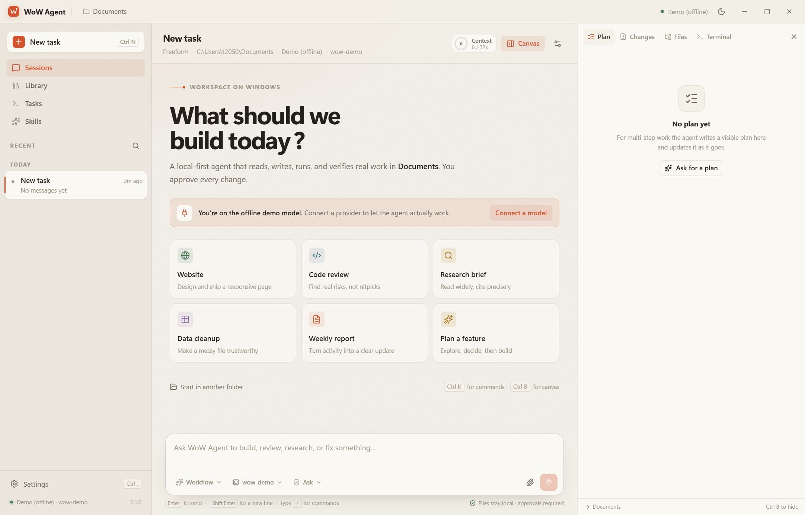

# WoW Agent

**A local-first AI workbench for Windows.** Full-stack TypeScript, built as a real desktop app — not a chat wrapper.

WoW Agent pairs a Kimi Code–style **agent harness** (streaming loop, permission boundary, subagents, plan mode, hooks, compaction, checkpoints) with a Vetta-style **workspace UI** (sessions on the left, task canvas on the right, a composer that carries workflow/model/permission mode, and deliverables that can be deposited into a knowledge library).



## What it does

- Works in a real folder on your machine: reads, searches, edits, runs commands, verifies results.
- Streams every model response and tool call into a reviewable timeline.
- Asks for approval before writes and shell commands. Plan mode is read-only.
- Delegates to isolated **explore / plan / coder** subagents.
- Tracks a visible plan, file diffs, background tasks, and per-turn checkpoints you can undo.
- Keeps a local knowledge library and reusable `SKILL.md` instruction bundles.
- Brings your own model: Moonshot Kimi, DeepSeek, OpenAI, Anthropic, OpenRouter, Ollama, or any OpenAI-compatible endpoint.
- Ships with an offline demo provider so the harness can be explored without a key.

## Quick start

Requirements: **Windows 10/11**, Node.js 20+ (developed on Node 24).

```bash
npm install
npm run dev
```

On first launch the app opens in your **Documents** folder with the offline demo model. Open **Settings → Models** to add a provider and key, then pick the model in the composer.

> The Electron binary is downloaded by its own install script. If the download is blocked, use a mirror:
> `ELECTRON_MIRROR=https://npmmirror.com/mirrors/electron/ node node_modules/electron/install.js`

### Production build

```bash
npm run build        # main + preload + renderer into out/
npm run package      # Windows NSIS installer + portable exe into release/
```

Packaging needs the electron-builder binaries. On restricted networks:

```bash
ELECTRON_MIRROR=https://npmmirror.com/mirrors/electron/ \
ELECTRON_BUILDER_BINARIES_MIRROR=https://npmmirror.com/mirrors/electron-builder-binaries/ \
npm run package
```

The current build produces `release/WoW Agent-0.1.0-x64.exe` (installer) and `release/WoW Agent-0.1.0-portable.exe`. They are unsigned, so Windows SmartScreen will warn on first run.

### Browser preview (no Electron)

```bash
npm run preview:web
# http://localhost:5199
```

The renderer falls back to an in-memory mock bridge with a seeded workspace, so the entire interface can be inspected in a normal browser. The real app uses the typed IPC bridge instead.

## Using the workspace

| Area | What it does |
| --- | --- |
| **Sidebar** | New task, sessions grouped by date, Library, Tasks, Skills, settings. |
| **Composer** | Workflow, model, permission mode, attachments, slash commands. `Enter` sends, `Shift+Enter` adds a line. |
| **Timeline** | User/assistant messages, reasoning, tool cards, plans, approvals, questions, subagent traces, diffs. |
| **Canvas** | **Plan** (live todos + approved plan), **Changes** (turn-grouped diffs + undo), **Files** (tree + preview), **Terminal** (live shell output). |
| **Library** | Notes and artifacts saved manually or by the agent. Searchable and reusable across tasks. |
| **Tasks** | All shell runs with status, output, exit code, and stop controls. |
| **Skills** | Built-in and workspace `SKILL.md` bundles. |

Keyboard: `Ctrl K` command palette · `Ctrl N` new task · `Ctrl B` canvas · `Ctrl ,` settings · `/` slash commands · `Esc` close overlays.

### Permission modes

| Mode | Behavior |
| --- | --- |
| **Ask** | Read-only tools auto-run. Writes and shell commands require approval. |
| **Auto** | Everything runs. Use only in trusted folders. |
| **Plan** | Read-only. The agent must present a plan via `exit_plan_mode`; implementation starts only after you approve. |

“Always allow” is scoped to the current task and inherited by subagents. It is not global.

### Workflows

The six starter workflows (Website, Code review, Research brief, Data cleanup, Weekly report, Plan a feature) prime the composer and add a system hint. They never auto-send.

## Architecture

```text
┌──────────────────────────── Renderer (React 19 + Zustand) ────────────────────────────┐
│  Sidebar · Timeline · Composer · Canvas · Library · Tasks · Skills · Settings        │
└───────────────────────────────────┬───────────────────────────────────────────────────┘
                                    │ typed IPC (contextBridge, contextIsolation, sandbox)
┌───────────────────────────────────▼───────────────────────────────────────────────────┐
│ Preload: window.wow                                                                   │
└───────────────────────────────────┬───────────────────────────────────────────────────┘
                                    │
┌───────────────────────────────────▼───────────────────────────────────────────────────┐
│ Main process                                                                          │
│  AgentRuntime ── permissions ── tools ── subagents ── compaction ── hooks             │
│  Providers (OpenAI-compatible / Anthropic / demo)                                     │
│  Sessions · Settings + DPAPI secrets · Library · Skills · Tasks · Checkpoints         │
└───────────────────────────────────┬───────────────────────────────────────────────────┘
                                    │
                          Workspace files · Git Bash · OS keystore
```

- **The renderer never touches the filesystem or model APIs.** Every action goes through validated IPC.
- **The agent loop lives in main**, so closing/reloading the UI does not corrupt a run.
- **Sessions are plain JSON** under `%APPDATA%\WoW Agent\sessions\`; API keys are encrypted with Windows DPAPI via Electron `safeStorage`.
- **Every tool has a risk class** (`read`, `write`, `execute`, `network`, `agent`) and a schema validated before execution.

See [docs/ARCHITECTURE.md](docs/ARCHITECTURE.md) for the full design, including the harness loop, permission rules, subagent isolation, context compaction, hooks, and IPC security.

## Agent harness highlights

- **Streaming loop** with text, reasoning, tool-call accumulation, usage accounting, abort, and step limits.
- **19 tools** across files, search, shell/background tasks, web, planning, delegation, questions, skills, and knowledge.
- **Read-before-write** enforcement plus on-disk hash checks: edits fail if the file changed since it was read.
- **Approval cards** with tool, risk, target, and “allow once / always allow / deny”.
- **Subagents** run in isolated context and return only their final answer; nested activity is visible but never pollutes the main history. They cannot delegate further.
- **Plan mode** blocks writes and commands at the execution boundary, not just in the prompt.
- **Context compaction** summarizes older turns when the window fills, with a hard-trim fallback.
- **Checkpoints** group file changes by turn; **Undo** restores the previous content after verifying the file has not changed.
- **Hooks** (`.wow/hooks.json`) can run commands before/after tools and prompts; exit code 2 blocks a tool.
- **Skills** are loaded on demand from Markdown, keeping the base prompt small.

## Project layout

```text
src/
  main/                  Electron main process
    agent/               harness loop, tools, providers, subagents, hooks
    services/            settings, secrets, sessions, library, skills
    ipc.ts, window.ts, index.ts
  preload/               contextBridge API
  renderer/              React app, design system, mock bridge
  shared/                domain types, IPC channels, workflows, presets
tests/                   unit + harness integration tests
docs/                    architecture and screenshots
scripts/cdp.mjs          dev-only CDP screenshot/eval helper
```

## Verification

```bash
npm run typecheck   # main + preload + renderer
npm test            # 11 tests: tools, SSE, paths, storage, approvals, plan mode, subagents, revert
npm run build
npm run package
```

The harness tests drive the real `AgentRuntime` with a scripted provider: tool loops, approval → write → checkpoint → revert, plan-mode blocking, subagent delegation, and stopping a run mid-approval.

## Security notes

- `contextIsolation: true`, `nodeIntegration: false`, `sandbox: true`; no remote module.
- IPC validates paths and restricts file previews to known workspaces/home.
- `web_fetch`/`web_search` are the only outbound network calls the agent can make; model traffic goes only to your configured provider.
- Grep skips `.env*`, keys, and credential files by default.
- Workspace hooks and project instructions are treated as untrusted content.
- API keys never cross the IPC bridge back to the renderer.
- The demo provider is offline and performs no network calls.

## Design credits

- **Agent harness** inspired by [Kimi Code](https://www.kimi.com/code): agent loop, permission boundary, subagents, plan mode, hooks, sessions/context.
- **Workspace interaction** inspired by [Vetta](https://www.openvetta.com/): session rail, task canvas, workflow-aware composer, deliverables, knowledge library.

This is an independent implementation; it is not affiliated with Moonshot AI or Vetta.

## License

MIT. See [LICENSE](LICENSE).
